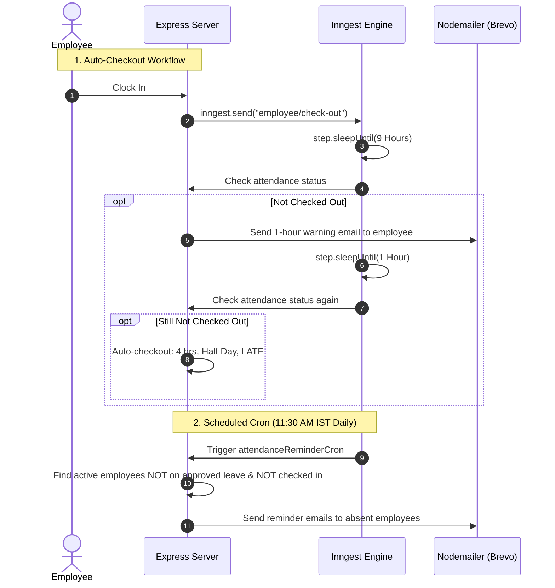

# StaffSync — Master Interview Preparation & Project Guide

> **Emergency 2-Hour Study Guide**  
> Written specifically for your upcoming technical interview. This document assumes **zero prior knowledge** of MERN, Inngest, or backend architecture and takes you from ground zero to sounding like an experienced full-stack engineer who built this system from scratch.

---

## Table of Contents
1. [The 60-Second "Elevator Pitch" (Memorize This)](#1-the-60-second-elevator-pitch)
2. [What is the Tech Stack? (Plain-English Explanations)](#2-what-is-the-tech-stack)
   - What is MERN? (MongoDB, Express, React, Node.js)
   - What is Inngest? (Your Secret Weapon)
   - What is JWT & bcrypt?
   - What is Tailwind CSS & Vite?
   - What is Nodemailer & Brevo?
3. [Architecture & The Lifecycle of a Request](#3-architecture--request-lifecycle)
4. [Deep Dive: The 5 Core Modules of StaffSync](#4-deep-dive-the-5-core-modules)
   - 4.1 Authentication & Role-Based Access Control (RBAC)
   - 4.2 Employee Management & Soft Deletes
   - 4.3 Smart Attendance & Compound Indexes
   - 4.4 Leave Application & Multi-Status Workflows
   - 4.5 Payroll Calculation & Printable Payslips
5. [The Crown Jewel: How Inngest Automation Works](#5-the-crown-jewel-inngest-automation)
6. [Design Decisions: "Why Did You Choose X Over Y?"](#6-design-decisions-why-x-over-y)
7. [The "Toughest Challenges & Bugs I Solved" (Golden Interview Answers)](#7-toughest-challenges--bugs-solved)
8. [Comprehensive Interview Questions & Model Answers](#8-comprehensive-interview-questions--answers)
   - Category A: Fundamental MERN Stack Questions
   - Category B: Project-Specific Architecture Questions
   - Category C: Tricky & Edge-Case Questions
   - Category D: System Design & Scalability Questions
9. [2-Hour Rapid Revision Checklist & Cheat Sheet](#9-2-hour-rapid-revision-checklist)

---

## 1. The 60-Second "Elevator Pitch"

When the interviewer asks: **"Tell me about your project StaffSync"** or **"Walk me through the main project on your resume"**, do **not** say *"It's a website where people can log in and see employees."*

**Say this word-for-word instead:**

> "StaffSync is an enterprise Employee Management System built on the MERN stack—React 19, Node.js, Express 5, and MongoDB—designed to streamline HR workflows, payroll, and daily workforce operations.
> 
> What sets StaffSync apart from typical CRUD apps is its **event-driven workflow automation powered by Inngest**. Instead of relying on brittle local cron jobs or complex message queues, I integrated Inngest for durable background tasks:
> 1. It monitors active shifts and triggers automated notifications or auto-checkouts after a 9-to-10 hour threshold.
> 2. It escalates unattended leave requests to administrators after 24 hours.
> 3. It runs a scheduled daily cron job to identify and email employees who have forgotten to mark their attendance.
> 
> On the frontend, I used React 19, Tailwind CSS v4, and React Router v7 with dual-portal role-based access control for Admins and Employees. On the backend, I designed relational-like integrity in MongoDB using compound unique indexing, soft-deletes for employee records, and JWT-based authentication."

*(This immediately signals that you understand architecture, asynchronous event handling, and real-world system design.)*

---

## 2. What is the Tech Stack? (Plain-English Explanations)

### 2.1 What is MERN?
MERN is an acronym for four technologies that use **JavaScript across the entire stack**:

1. **M = MongoDB (Database)**
   - **What it is**: A NoSQL, document-oriented database.
   - **How to explain it**: "Instead of storing data in rigid SQL tables with rows and columns, MongoDB stores data in flexible, JSON-like documents called BSON. In StaffSync, we have collections for `users`, `employees`, `attendances`, `leaveapplications`, and `payslips`."
   - **Mongoose**: The Object Data Modeling (ODM) library for MongoDB in Node.js. It lets us define strict schemas, default values, and data validations.

2. **E = Express.js (Backend Web Framework)**
   - **What it is**: A lightweight framework running on top of Node.js.
   - **How to explain it**: "Express makes it easy to create REST API endpoints (like `GET /api/employees` or `POST /api/attendance`), handle HTTP requests/responses, and apply middleware functions like authentication checks."

3. **R = React 19 (Frontend Library)**
   - **What it is**: A component-based JavaScript library for building user interfaces.
   - **How to explain it**: "React allows us to build reusable UI components (like `EmployeeCard` or `AttendanceStats`). It uses a Virtual DOM to efficiently update only the parts of the web page that change without reloading the whole browser."

4. **N = Node.js (Runtime Environment)**
   - **What it is**: An engine that lets JavaScript run on your computer/server, not just inside a web browser.
   - **How to explain it**: "Node.js uses Google Chrome's V8 engine and has an asynchronous, non-blocking event-driven architecture, making it fast and lightweight for I/O operations like database queries and API calls."

---

### 2.2 What is Inngest? (Your Secret Weapon)
*Interviewers will be fascinated by this because 95% of candidates only build basic CRUD apps.*

* **The Problem**: 
  Suppose an employee checks in at 9:00 AM. You want the system to wait 9 hours. If they haven't checked out by 6:00 PM, send them an email. If they still haven't checked out at 7:00 PM (10 hours), automatically check them out as "Half Day - Late".
  - *Can you use `setTimeout()`?* **No!** If the server restarts or crashes during those 9 hours, the timer dies. Plus, on modern platforms like Vercel or AWS Lambda, serverless functions terminate after 10–30 seconds!
  - *Can you use Redis + BullMQ?* You could, but that requires setting up a dedicated Redis server, managing worker processes, and handling retries manually.
* **The Solution (Inngest)**:
  - Inngest is a **durable execution engine**.
  - When an employee clocks in, our code fires a lightweight event: `inngest.send({ name: "employee/check-out", data: ... })`.
  - Inngest receives the event, pauses execution using `await step.sleepUntil("wait-9-hours", ...)`, and stores the state safely in the cloud **without keeping our server running or consuming CPU/RAM**.
  - 9 hours later, Inngest calls back into our server endpoint (`/api/inngest`) to execute the next line of code, send the reminder email, wait 1 more hour, and finalize attendance.
  - If our server restarts, Inngest automatically retries without losing data.

---

### 2.3 What is JWT & bcrypt?
* **bcrypt**: A password-hashing library. We **never** store raw passwords in a database. When a user creates an account or changes their password, `bcrypt.hash(password, 10)` adds a cryptographic "salt" and hashes it. During login, `bcrypt.compare(enteredPassword, storedHash)` verifies if they match.
* **JWT (JSON Web Token)**:
  - A compact, URL-safe token representing the user's identity.
  - When the user logs in, the server generates a token signed with a secret key (`process.env.JWT_SECRET`):
    ```javascript
    jwt.sign({ userId, role, email }, process.env.JWT_SECRET, { expiresIn: "7d" });
    ```
  - The frontend saves this token in `localStorage`.
  - On every future API request, Axios automatically sends this token in the header:  
    `Authorization: Bearer <token>`.
  - The server verifies the signature. If valid, the user is authenticated **without the server having to store sessions in memory** (stateless authentication).

---

### 2.4 What is Tailwind CSS & Vite?
* **Vite**: The modern build tool and development server. It replaces older tools like Webpack. It uses native ES Modules (ESM) in the browser, making development server startup and Hot Module Replacement (HMR) virtually instantaneous.
* **Tailwind CSS v4**: A utility-first CSS framework. Rather than writing separate `.css` files with custom class names, you apply utility classes directly in JSX (`p-4 bg-white rounded-xl shadow-md`). Version 4 features a pure CSS configuration engine (`@import "tailwindcss";`) that eliminates bulky config files.

---

### 2.5 What is Nodemailer & Brevo?
* **Nodemailer**: A Node.js module that allows applications to send emails.
* **Brevo (formerly Sendinblue)**: A cloud SMTP relay provider (`smtp-relay.brevo.com:587`). We connect Nodemailer to Brevo using SMTP credentials to send transactional emails (clock-out reminders, leave notifications, daily attendance warnings).

---

## 3. Architecture & Request Lifecycle

To impress the interviewer, walk them through **what happens when an employee clicks "Clock In"**:

```
[User Browser]
      │
      │ 1. Clicks "Clock In" button in CheckInButton.jsx
      ▼
[Axios Interceptor] (client/src/api/axios.js)
      │ 2. Reads JWT from localStorage
      │ 3. Injects header: `Authorization: Bearer <token>`
      ▼
[Express Server] (server/server.js)
      │ 4. Route matches: POST /api/attendance
      ▼
[protect Middleware] (server/middleware/auth.js)
      │ 5. jwt.verify(token, JWT_SECRET)
      │ 6. Attaches decoded payload (userId, role) to req.session
      ▼
[attendanceController.clockInOut] (server/controllers/attendanceController.js)
      │ 7. Finds Employee document by req.session.userId
      │ 8. Checks if employee isDeleted (if true, rejects with 403)
      │ 9. Queries Attendance model for today's date
      │ 10. Computes if late (now > 9:00 AM) -> status: "LATE" : "PRESENT"
      │ 11. Attendance.create({ employeeId, date: today, checkIn: now, status })
      │
      ├─────────────────────────────────────────┐
      │                                         │
      ▼                                         ▼
[MongoDB Database]                      [Inngest Cloud Engine]
Saves attendance document               Emits event: "employee/check-out"
(Compound index ensures 1/day)          (Starts 9h/10h auto-checkout flow)
      │                                         │
      ▼                                         ▼
Returns JSON response to client         Sleeps safely in background
UI updates button to "Clock Out"
```

---

## 4. Deep Dive: The 5 Core Modules of StaffSync

### 4.1 Authentication & Role-Based Access Control (RBAC)
* **Two Roles**: `"ADMIN"` and `"EMPLOYEE"`.
* **Dual Login Portals**:
  - `/login/admin` passes `role_type: "admin"` to the backend.
  - `/login/employee` passes `role_type: "employee"` to the backend.
  - If an employee tries to sign into the admin portal, `authController.js` blocks them with: `"Not authorized as admin"`.
* **Route Protection on Backend**:
  - `protect`: Verifies valid JWT token.
  - `protectAdmin`: Ensures `req.session.role === "ADMIN"`. Applied to critical routes:
    - Creating/updating/deleting employees (`employeeRoutes.js`)
    - Approving/rejecting leaves (`leaveRoutes.js`)
    - Generating payslips (`payslipsRoutes.js`)
* **Route Protection on Frontend**:
  - `Layout.jsx` checks `useAuth()`. If no user is logged in, it redirects immediately to `/login`.
  - `Sidebar.jsx` dynamically conditionally renders nav items:
    - Admins see: *Dashboard, Employees, Leave, Payslips, Settings*.
    - Employees see: *Dashboard, Attendance, Leave, Payslips, Settings*.

---

### 4.2 Employee Management & Soft Deletes
* **Data Separation**:
  - `User` model stores `{ email, password, role }`.
  - `Employee` model stores personal/employment info `{ firstName, lastName, phone, position, department, basicSalary, allowances, deductions, joinDate, bio }` and holds a reference `userId: { type: ObjectId, ref: "User" }`.
  - *Why this design?* If authentication mechanisms change (e.g., OAuth/Google Login), the core employee entity remains untouched.
* **The "Soft Delete" Pattern**:
  - In `employeeController.deleteEmployee`, we **do not** run `Employee.findByIdAndDelete()`.
  - Instead, we set:
    ```javascript
    employee.isDeleted = true;
    employee.employmentStatus = "INACTIVE";
    await employee.save();
    ```
  - *Why?* If you hard-delete an employee, you break database integrity! Past payslips and historical attendance records would point to a non-existent ID. Soft delete retains historical compliance while deactivating active access.

---

### 4.3 Smart Attendance & Compound Indexes
* **Database Guard**:
  ```javascript
  attendanceSchema.index({ employeeId: 1, date: 1 }, { unique: true });
  ```
  - This compound index guarantees at the database level that an employee can never have two attendance records on the same calendar day.
* **Late Calculation**:
  - If check-in time is after 9:00 AM (`now.getHours() >= 9 && now.getMinutes() > 0`), status is marked `"LATE"`. Otherwise `"PRESENT"`.
* **Day Type Classification**:
  - When the employee clocks out, total hours worked are computed:
    - $\ge 8$ hours: `"Full Day"`
    - $\ge 6$ hours: `"Three Quarter Day"`
    - $\ge 4$ hours: `"Half Day"`
    - $< 4$ hours: `"Short Day"`

---

### 4.4 Leave Application & Multi-Status Workflows
* **Leave Types**: `"SICK"`, `"CASUAL"`, `"ANNUAL"`.
* **Validation**:
  - Dates must be strictly in the future (`startDate > today` and `endDate >= startDate`).
  - Deactivated (`isDeleted`) accounts are blocked from applying.
* **Workflow**:
  1. Employee submits leave $\rightarrow$ Saved with `status: "PENDING"`.
  2. Emits Inngest event: `"leave/pending"`.
  3. Inngest waits 24 hours. If still pending, it emails the Admin.
  4. Admin can visit the `/leave` page and click **Approve** or **Reject** (`PATCH /api/leave/:id`), instantly updating the employee's status badge.

---

### 4.5 Payroll Calculation & Printable Payslips
* **Formula**:
  $$\text{Net Salary} = \text{Basic Salary} + \text{Allowances} - \text{Deductions}$$
* **Admin Flow**:
  - Admin selects an employee, chooses Month and Year, enters or confirms allowances and deductions, and clicks "Generate".
* **Printable Payslip**:
  - Dedicated route: `/print/payslips/:id`.
  - Renders a clean invoice layout with company header, employee details, salary breakdown table, and a "Print Payslip" button that triggers `window.print()`. Includes Tailwind's `print:hidden` utility to hide buttons during printing.

---

## 5. The Crown Jewel: How Inngest Automation Works

Here are the 3 Inngest functions implemented in `server/inngest/index.js` that you should explain in detail:



### Why this is architecturally superior:
1. **Serverless Compatibility**: Traditional servers crash or restart; serverless functions timeout. Inngest steps survive across cold starts and deploy updates.
2. **Step Memoization**: If Step 1 succeeds and Step 2 fails (e.g. SMTP server temporarily down), Inngest only retries Step 2. It **never** re-runs Step 1 (preventing duplicate emails or duplicate database writes).

---

## 6. Design Decisions: "Why Did You Choose X Over Y?"

Interviewers frequently test senior-level thinking by asking why you selected a certain technology or approach:

### Q: Why MongoDB over PostgreSQL / MySQL?
> **Answer**: "While an EMS has relational aspects (Employees have Attendances), MongoDB provided rapid iteration speed with dynamic schema flexibility. Features like bio descriptions and custom allowance structures map naturally to document structures. To preserve relational integrity, I used Mongoose references (`ObjectId`) with `.populate()` and enforced uniqueness via compound indexes."

### Q: Why Inngest instead of `node-cron` or `setInterval`?
> **Answer**: "Local node timers like `node-cron` or `setInterval` live only in server memory. If the server scales to multiple instances, reboots during a deployment, or runs on a serverless platform like Vercel, timers get duplicated or killed. Inngest provides **durable execution**: steps are persisted statefully, retries are handled with exponential backoff, and crons are centrally scheduled regardless of server infrastructure."

### Q: Why JWT in `localStorage` instead of Server-Side Sessions?
> **Answer**: "JWTs enable a stateless backend. The server doesn't need a Redis session store to verify logged-in users across horizontally scaled instances—it simply validates the cryptographic signature. In an enterprise system where mobile apps or third-party services might consume the same API, Bearer tokens offer seamless cross-platform support."

### Q: Why Soft Deletes instead of Hard Deletes?
> **Answer**: "In HR and payroll systems, data auditing is a legal and operational requirement. If an employee leaves the company, hard-deleting their record would corrupt historical payslips, tax calculations, and annual attendance records. By setting `isDeleted: true` and `employmentStatus: 'INACTIVE'`, we restrict login and clock-in capabilities while preserving complete audit logs."

---

## 7. Toughest Challenges & Bugs Solved

Every interviewer asks: **"What was a difficult technical challenge or bug you encountered, and how did you resolve it?"** Pick one of these two real scenarios from this codebase:

### Scenario 1: The Double Check-In Race Condition
* **The Problem**: If an employee clicked the "Clock In" button twice rapidly (or had poor internet connectivity), two concurrent HTTP requests hit the server, creating two distinct check-in records for the same day.
* **The Solution**: "I solved this at the database level rather than just in application code. I added a compound unique index in Mongoose:
  ```javascript
  attendanceSchema.index({ employeeId: 1, date: 1 }, { unique: true });
  ```
  Even if concurrent requests bypass the application-level check, MongoDB rejects the duplicate with error code `11000`, guaranteeing single check-in integrity."

### Scenario 2: Serverless Function Timeouts with Long Shifts
* **The Problem**: "I needed to implement automated checkout reminders after 9 hours of work. In modern cloud hosting (like Vercel), an HTTP request or background thread times out after 10–30 seconds. A traditional `setTimeout` or long-polling thread was impossible."
* **The Solution**: "I integrated Inngest's event-driven durable workflows. When the employee clocks in, we dispatch an event and exit the HTTP handler immediately ($<100\text{ms}$). Inngest orchestrates the 9-hour delay externally using `step.sleepUntil()`, re-invoking our webhook endpoint only when the timer expires. This made long-running business workflows possible on a serverless architecture without keeping servers warm."

---

## 8. Comprehensive Interview Questions & Answers

### Category A: Fundamental MERN Stack Questions

#### 1. What are React Hooks, and which ones did you use in StaffSync?
**Answer**: Hooks are functions that let you use state and lifecycle features in functional components without writing class components. In StaffSync:
* `useState`: Manages local UI states (e.g., modal visibility, search inputs, form loading flags).
* `useEffect`: Runs side effects (e.g., fetching profile data on mount, auto-closing mobile sidebar on route change).
* `useCallback`: Memoizes fetch functions (like `fetchEmployees` in `Employees.jsx`) to prevent unnecessary re-creations across re-renders.
* `useContext`: Accesses global `AuthContext` (current user, token, login/logout methods) from any component without prop drilling.
* `useParams`: Extracts URL route parameters (e.g., `:id` in `/print/payslips/:id`).
* `useNavigate`: Programmatically redirects users (e.g., sending users to `/dashboard` after login).

#### 2. What is Express Middleware, and how does `protect` work?
**Answer**: Middleware functions are functions that have access to the Request object (`req`), Response object (`res`), and the next function in the application’s request-response cycle (`next`).
In our `protect` middleware:
1. It inspects `req.headers.authorization`.
2. Checks if it starts with `"Bearer "`.
3. Verifies the token using `jwt.verify(token, process.env.JWT_SECRET)`.
4. If valid, attaches the decoded payload to `req.session = session` and calls `next()` to pass control to the controller.
5. If missing or invalid, immediately returns `res.status(401).json({ error: "Unauthorized" })`.

#### 3. What is the difference between SQL and NoSQL (MongoDB)?
**Answer**: SQL databases are relational, table-based, and enforce strict structured schemas with predefined foreign keys. NoSQL databases like MongoDB are non-relational, document-oriented, and store data in flexible JSON/BSON structures. MongoDB excels at horizontal scalability and fast iterations where document schemas can evolve.

---

### Category B: Project-Specific Architecture Questions

#### 4. How does StaffSync handle unauthorized access to Admin pages?
**Answer**: We employ defense-in-depth on both layers:
* **Backend Layer (Authoritative)**: Critical routes apply `protectAdmin` middleware. If `req.session.role !== "ADMIN"`, the server returns a `403 Forbidden`. Even if a user bypasses the UI, the API refuses to serve data.
* **Frontend Layer (UX)**: The UI conditionally hides Admin controls (like "Add Employee" buttons or the Employees menu item). Protected pages redirect non-authenticated sessions back to `/login` via `Layout.jsx`.

#### 5. Walk me through the database relationship between `User` and `Employee`.
**Answer**: It is a 1-to-1 relationship. The `Employee` schema holds a `userId` field:
```javascript
userId: { type: mongoose.Schema.Types.ObjectId, ref: "User", required: true, unique: true }
```
When an Admin creates an employee in `employeeController.createEmployee`:
1. It hashes the temporary password and creates a `User` record with role `"EMPLOYEE"`.
2. It takes the newly created `user._id` and inserts the `Employee` record referencing that ID.
3. When querying employees, we use Mongoose's `.populate("userId", "email role")` to fetch linked credentials.

#### 6. How is salary calculated when generating a payslip?
**Answer**:
```javascript
const netSalary = Number(basicSalary) + Number(allowances || 0) - Number(deductions || 0);
```
The server validates that all fields are numeric, calculates `netSalary`, saves it to the `Payslip` collection, and links it to `employeeId`.

---

### Category C: Tricky & Edge-Case Questions

#### 7. What happens if an employee checks in, but the Inngest service is down?
**Answer**: The check-in itself will still succeed! In `attendanceController.js`, the `Attendance.create()` runs and commits to MongoDB first. The `inngest.send()` is a decoupled background trigger. If Inngest is unreachable, we can catch the error without rolling back the employee's check-in, or configure fallback retry queues.

#### 8. Is storing JWT in `localStorage` completely secure? What are the tradeoffs?
**Answer**: "Storing JWTs in `localStorage` is convenient for Single Page Applications, but it is technically vulnerable to Cross-Site Scripting (XSS) if untrusted third-party scripts run on the page. 
A more secure alternative in production would be storing the token in an **`httpOnly`, `Secure`, `SameSite` cookie**. This prevents JavaScript from reading the token directly while still sending it automatically on network requests. For this phase of StaffSync, `localStorage` was chosen for rapid cross-origin flexibility between the client and server."

#### 9. What prevents an employee from clocking in for their friend?
**Answer**: "Clock-in requires logging in with the employee's personal credentials. The backend does not accept an arbitrary `employeeId` in the clock-in request body; instead, it derives the `employeeId` directly from `req.session.userId` extracted from the cryptographically verified JWT token. An employee can only ever clock in for their own authenticated account."

---

### Category D: System Design & Scalability Questions

#### 10. How would you scale StaffSync if the company grew to 100,000 employees?
**Answer**:
1. **Database Indexing & Sharding**: Index frequently queried fields (`department`, `date`, `status`). Shard the `Attendance` collection by date or department ranges to distribute load across MongoDB replica sets.
2. **Caching**: Introduce a Redis caching layer for read-heavy, low-frequency changing data like Department lists, public employee profiles, and company holidays.
3. **Pagination**: Replace bulk `find()` queries with cursor-based or limit/skip pagination (`limit=50`, `page=1`) so large lists don't overwhelm network bandwidth and browser memory.
4. **Horizontal Server Scaling**: Since the Express backend is stateless (JWTs), we can run multiple instances behind an Nginx or AWS Application Load Balancer.

---

## 9. 2-Hour Rapid Revision Checklist

Follow this exact revision sequence during your final 2 hours:

```
[00:00 - 00:20] ─► Memorize Section 1 (The 60-Second Elevator Pitch) out loud.
[00:20 - 00:50] ─► Read Section 2 (Tech Stack) & Section 5 (Inngest Automation).
[00:50 - 01:20] ─► Review Section 4 (The 5 Modules) & trace the Clock-In diagram.
[01:20 - 01:45] ─► Practice answering Section 7 (Challenges) & Section 8 (Q&A).
[01:45 - 02:00] ─► Quick scan of the Code Highlights below.
```

### Essential File Cheat Sheet
* **[server/server.js](file:///c:/Users/Star/Desktop/PARVA/Projects/StaffSync/server/server.js)**: Entry point, registers routes & Inngest endpoint (`/api/inngest`).
* **[server/middleware/auth.js](file:///c:/Users/Star/Desktop/PARVA/Projects/StaffSync/server/middleware/auth.js)**: JWT token validator (`protect`) & role guard (`protectAdmin`).
* **[server/inngest/index.js](file:///c:/Users/Star/Desktop/PARVA/Projects/StaffSync/server/inngest/index.js)**: Background automations (auto checkout, leave reminders, 11:30 AM cron).
* **[server/models/Attendance.js](file:///c:/Users/Star/Desktop/PARVA/Projects/StaffSync/server/models/Attendance.js)**: Unique compound index `{ employeeId: 1, date: 1 }`.
* **[client/src/context/AuthContext.jsx](file:///c:/Users/Star/Desktop/PARVA/Projects/StaffSync/client/src/context/AuthContext.jsx)**: Global authentication state & token persistence.
* **[client/src/api/axios.js](file:///c:/Users/Star/Desktop/PARVA/Projects/StaffSync/client/src/api/axios.js)**: Injects Bearer token into headers.

---
*Good luck with your interview! Walk in with confidence—you have a clear understanding of the architecture, engineering decisions, and codebase.*
